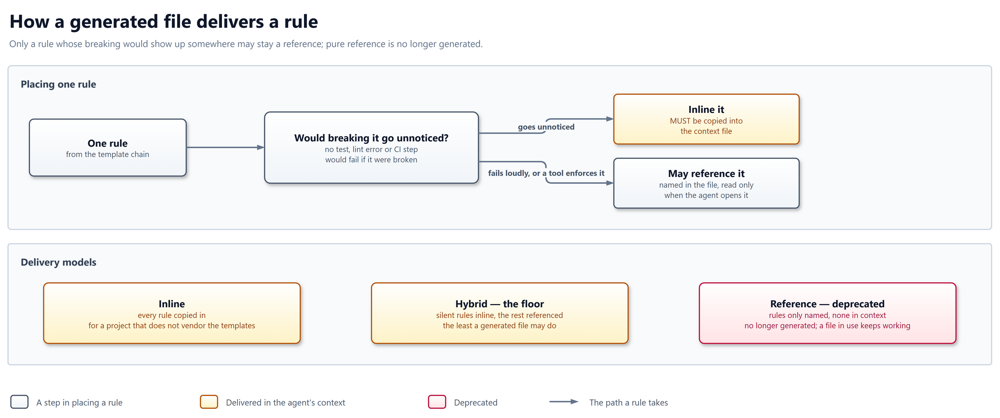

# 4. Solution strategy

Upstream keeps one set of shared rules and the tools that compose and
check them, and every stack, platform and team process lives in a fork. A
project's agent gets every rule whose breach is silent, with no tool to
catch it, copied into its context; any other rule may stay a reference.

## 4.1 Decomposition

| Decision | Why | Source |
|----------|-----|--------|
| One concern per template, which a fork or project extends or overrides by section ID and never edits | A rule changes in one place, and a fork merges upstream without editing it | ADR-001, ADR-004, FR-04-02, FR-04-03 |
| One manifest holds every template, its ID and its dependencies. A chain gets the core tier and only what its stack declares | One source of truth for the graph, and no rule reaches a project unasked | ADR-004, FR-03-01, FR-03-02, FR-03-03 |
| Upstream keeps the engine and shared policy; forks carry stacks, platforms, process and the interview, and merge upstream | Shared rules stay generic, and a fork stays current without copying files | ADR-049, ADR-050, FR-08-01, FR-08-02 |
| A rule whose breach is silent, and which no tool enforces, reaches the agent copied in. Any other rule may stay a reference | Nothing loads a referenced file, so a silent rule left there is missed, while a visible one still shows | ADR-052 |
| Each section declares where its rules load, on every turn or for a named task | The root file stays short, and a procedure loads only when its task starts | ADR-058, proposed; FR-06-01, QG-02-02 |
| A tool builds the root file and the task skills from the resolved chain | The same templates give every project the same files | ADR-058, proposed; FR-06-03, FR-06-06 |
| A mechanically checkable rule names its command and pass condition. Upstream gives every such check a disposition, and runs each one that applies to it | A rule upstream ships is one upstream obeys, and a skip states its reason | ADR-030, ADR-031, FR-07-01, QG-01-01 |
| The 3.x line freezes its contract, and a removal waits for the next major, except for a security fix | A project pins a release and moves the pin without rework | ADR-051, FR-09-01, FR-09-02, QG-03-02 |

## 4.2 Delivery model

A rule whose breach is silent, with no test, linter or CI step to catch it,
is copied into the context file. A rule that fails visibly, or that a tool
enforces, may stay a reference to the file that holds it.

## 4.3 Technology decisions

| Decision | Why | Source |
|----------|-----|--------|
| Plain Markdown for the templates | Any agent reads them, and no build step is required between a rule and the agent | ADR-007, FR-05-01, FR-05-04 |
| YAML for the manifest | A person and a tool read the same file | FR-03-01 |
| Python for the resolver, the tests and the hooks | One language for every tool and check, on every platform the maintainer and CI use | Chapter 2, 2.1 #1 |
| pre-commit to ship a check over 15 lines | A project runs a shipped check in its own CI, at a pinned revision | ADR-055, FR-07-02 |
| The open Agent Skills format for task skills | Several coding agents read it, so one set of files serves each of them | ADR-058, proposed; FR-05-04 |
