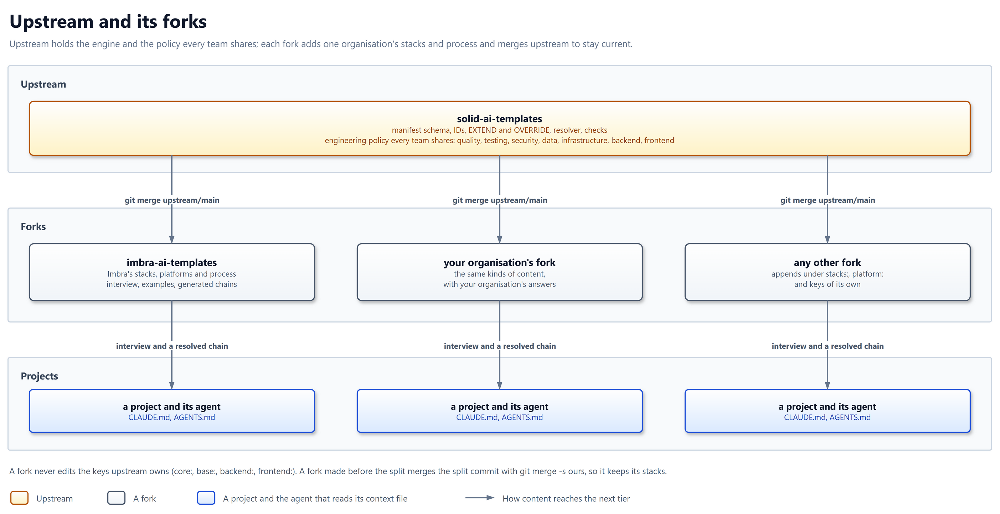

# ADR-049: Forks carry the stacks and the process layer

## Context

This repository holds two kinds of content, and only one of them is shared
by every team.

| Content | Examples | Who needs it |
| ------- | -------- | ------------ |
| Composition engine | Manifest schema, IDs, EXTEND and OVERRIDE, resolver, checks | Every project and every fork |
| Shared engineering policy | Quality, testing, security, data, infrastructure, backend, frontend | Every project |
| One organisation's choices | 17 stacks, 3 platforms, release and session process, interview, examples, generated chains | Projects that work the way Imbra works |

The forces:

- Contradiction: a review of the core found half of it is an operating
  manual. A team running a different process inherits rules that
  contradict its practice, a failure the efficacy benchmark tests for.
- Release coupling: every stack ships in every release, so a change to
  one organisation's process is a release for everyone.
- Size: the generated chains grew until the e2e canary hits the
  generator's output ceiling.
- Precedent: the previous scope decision already sent other
  organisations to their own repositories, but kept a curated stack set
  here.

## Decision

Upstream holds the composition engine and the policy every team shares;
forks carry the stacks, platforms, process layer, interview, examples and
generated chains, and stay current by merging upstream.

## Rationale

- One organisation's process binds only the projects that chose it, so no
  team inherits rules that contradict its practice.
- A new stack or a process change is a release of one fork, not of every
  consumer.
- A git fork receives upstream's fixes by merging; a copy drifts, and
  nothing carries a fix into it.
- Generation stays an agent reading Markdown, so a project needs no new
  tool.

## Design



| # | Rule | In practice |
| - | ---- | ----------- |
| 1 | Upstream holds the engine and shared policy | The manifest schema, IDs, EXTEND and OVERRIDE, the resolver, the checks, and the policy that holds for any team. Which file falls on which side is the boundary record's call (#1919) |
| 2 | Forks hold the rest | Stacks, platforms, the process layer, the interview, examples and generated chains. `imbra-ai-templates` is the first fork; any organisation MAY fork the same way |
| 3 | A fork merges upstream | A fork syncs with `git merge upstream/main`, never by copying files |
| 4 | A fork appends, never edits upstream keys | A fork MUST NOT edit `core:`, `base:`, `backend:` or `frontend:` in the manifest; it appends under `stacks:`, `platform:` and keys of its own, and adds to every chain's core tier under `fork_core:` |
| 5 | Forks own their ID prefixes | `stack-*`, `platform-*` and `<org>-*` are reserved for forks; upstream adds no ID under them |
| 6 | Upstream commits no derived content | No `generated/`, no `examples/`, no stack table; a fork regenerates its own |
| 7 | Fork-owned files conflict by design | `README.md`, `CLAUDE.md` and `CHANGELOG.md` belong to the fork, which resolves them in its own favour on every merge |
| 8 | The split merges with `ours` | Upstream lands the split as one commit. A fork that predates it merges the commit's parent normally, then the split commit with `git merge -s ours`; an ordinary merge deletes every file the fork left unchanged and upstream removed |
| 9 | Generation stays agent-driven | No compiler: a project hands its agent the interview and a resolved chain |
| 10 | Takes effect in v3.0 | Until then this repository carries both kinds of content, as it does today |

| Rule | Promise or mechanism | Enforced by |
| ---- | -------------------- | ----------- |
| 1, 2 | Promise to projects and forks | The boundary record (#1919) |
| 3, 9 | Mechanism | - |
| 4 | Promise to forks | The manifest ownership check (#1923) |
| 5 | Promise to forks | The duplicate-ID smoke check, which fires on the merge |
| 6, 7, 8 | Mechanism | The fork-sync CI job (#1924) and the migration guide (#1292) |
| 10 | Promise to projects | The compatibility record (#1921) |

### Merging the split

A fork made before v3.0 takes upstream's changes in three steps. Upstream
lands the split as one commit. Everything before it merges normally first:
`-s ours` marks a commit and all its ancestors as merged, so a change not
merged before it, such as the path move or a policy fix, is skipped for
good.

```bash
git remote add upstream https://github.com/solid-ai-dev/solid-ai-templates.git
git fetch upstream

# Everything before the split, the path move included, merges normally.
git merge <split-commit>^

# Upstream drops the stacks; the fork keeps them.
git merge -s ours <split-commit>

# Everything after the split merges normally.
git merge upstream/main
```

## Alternatives considered

| Alternative | Why not |
| ----------- | ------- |
| Keep the curated set here | One organisation's process stays in the shared core, and every stack ships in every release. |
| Stacks as a package or submodule | An install step for a user who only attaches a file to an agent, and a submodule pins rather than merges. |
| A stacks repository that copies the core | A copy drifts, and nothing carries an upstream fix into it. |
| A compiler that assembles context files | A build step becomes a dependency for every consumer, and the composition stops being Markdown an agent reads. |

## Consequences

| Consequence | Effect |
| ----------- | ------ |
| Boundary record | Assigns each template to upstream or to forks (#1919) |
| Compatibility record | States what upstream freezes from `3.0.0`, so a fork can rely on the IDs it extends (#1921) |
| Ownership check | Smoke fails when a fork edits an upstream manifest key (#1923) |
| Fork-sync CI job | Simulates a fork, lands an upstream change, and asserts the merge is clean (#1924) |
| Fixture stack and platform | The per-stack checks keep an input once the stacks leave (#1925) |
| README rewrite | The fork model replaces the stacks table; the extension-model issue closed on this record (#305) |
| Migration guide | Documents the merge steps above and the ownership rule (#1292) |

## Compatibility

- Until v3.0 nothing changes. `v2.90.0` stays the pin a consumer holds
  until it migrates.
- From v3.0, a project that resolves a stack, a platform, the interview or
  a generated chain from upstream finds them gone. It re-pins to a fork that
  carries them; Imbra's fork keeps today's IDs, so the project's EXTEND and
  OVERRIDE directives still resolve.
- A project that builds only on upstream's shared policy keeps working
  against upstream, on the IDs the compatibility record freezes.
- A fork made before the split loses every stack it left unchanged if it
  merges the split normally; the merge steps above prevent that.
- The removal ships as a major release, under `Breaking changes` in the
  CHANGELOG. How long 2.x receives fixes is the compatibility record's
  call (#1921).

## Security

- Trust moves to the fork's maintainer. A context file instructs an agent
  that can run commands, and a shipped check is code the agent runs, so a
  project trusts whoever maintains the fork it pins. A project SHOULD pin a
  fork by tag or commit, not by branch.
- The ownership rule guards upstream's manifest keys, not what they mean
  in a chain. A fork can OVERRIDE an upstream security section from one of
  its own stacks, and no upstream check sees it.
- `SECURITY.md` routes reports about upstream only. Each fork needs its
  own disclosure route for the content it adds.
- No credentials or secrets are involved.

## Related

- ADR-009 - the curated stack set this record supersedes.
- solid-ai-dev/solid-ai-templates#1919 - the boundary record.
- solid-ai-dev/solid-ai-templates#1921 - the compatibility record.
- solid-ai-dev/solid-ai-templates#305 - the extension model this record
  answers.
