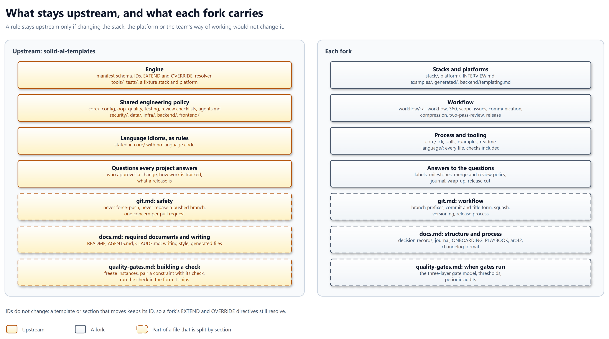

# ADR-050: What stays upstream, and what each fork carries

## Context

The fork model leaves one question open: which template, and which part of
a template, stays upstream. An audit of every core and workflow section,
measured on 2026-09-03 (#1480), found:

| Verdict | Share of the core and workflow bytes |
| ------- | ------------------------------------ |
| Policy that holds for any team | 38.4 % |
| One team's process | 49.3 % |
| Stack or platform content | 11.1 % |
| Language content | 1.1 % |

The forces:

- Different teams: teams run trunk-based, gitflow, review-required or solo
  models. Upstream's answers to how work flows make the file wrong for every
  team that works otherwise.
- Mixed files: `git.md`, `docs.md` and `quality-gates.md` hold policy and
  process side by side, so a whole-file split cannot separate them.
- Layout: `templates/base/` no longer says who owns what, now that backend
  and frontend are abstractions too (#1504).
- Stable references: forks and projects extend upstream sections by ID, so
  a move that renames an ID breaks them.

## Decision

Upstream keeps the rules that hold whatever a team's stack, platform or way
of working, and asks the questions a project must answer about how it works;
every answer to those questions moves to forks.

## Rationale

- The waist test from the audit decides each rule by one question, so the
  boundary does not rest on taste.
- A team's governance is right for that team only; asking the question keeps
  upstream right for all of them, and each fork supplies its own answer.
- History-safety rules in git hold for every team; branch prefixes and title
  forms are one team's choice.
- Which documents a project keeps, and how each is laid out, differ across
  teams and organisations. Upstream requires only the documents every
  project needs, `README.md`, `AGENTS.md` and `CLAUDE.md`, and prescribes
  no document's structure, so the core stays as lean as the waist test
  allows.

## Design

| # | Rule | In practice |
| - | ---- | ----------- |
| 1 | The waist test | A rule stays upstream only if changing the stack, the platform or the team's way of working would not change it |
| 2 | Engine upstream | The manifest schema, IDs, EXTEND and OVERRIDE, the resolver, `tools/`, `tests/`, and a fixture stack and platform as test input |
| 3 | Shared policy upstream | `core/`: config, oop, quality, testing, the review checklists, and `agents.md` as the output contract; `security/`, `data/`, `infra/`, `backend/` and `frontend/` |
| 4 | Rules, not language checks | `core/` states each idiom's rule language-neutrally and carries no language-specific code; the check moves with `language/`, which leaves upstream whole (#1926) |
| 5 | Governance asks, forks answer | Upstream asks who approves a change, how work is tracked and what a release is, and answers none of them. Labels, milestones, merge and review policy, the journal, wrap-up and the release cut move to forks |
| 6 | Git splits | Upstream keeps never force-push, never rebase a pushed branch, one concern per pull request, committer identity, submodules, off-limits paths and `.gitignore`. Branch prefixes, commit and title form, squash policy, versioning and the release process move |
| 7 | Required documents, no structure | Upstream requires `README.md`, `AGENTS.md` and `CLAUDE.md` and prescribes no document's structure. `core/readme.md`, decision records (threshold, layout, immutability, schema and layout checks), the changelog format, arc42, and the ONBOARDING, PLAYBOOK and journal rules move |
| 8 | Workflow moves | All of `workflow/` moves, `release.md` included. From `quality-gates.md`, how a check is built stays; when gates run moves: the three-layer gate model, thresholds and periodic audits |
| 9 | Ends move | `stack/`, `platform/`, `INTERVIEW.md`, `examples/`, `generated/`, `backend/templating.md`, `language/`, and `core/` cli, skills and examples |
| 10 | Concern directories | Upstream drops `base/`: `core/`, `security/`, `data/` and `infra/` sit beside `backend/` and `frontend/` under `templates/` (#1504) |
| 11 | IDs never change | A file or section keeps its ID when it moves or splits, so every EXTEND and OVERRIDE still resolves; a split file's moved sections go to a fork-owned file |
| 12 | The audit is the starting list | Each section not named above is placed by rule 1; the audit's per-section verdicts are the starting list, checked against the test as the path move lands (#1480) |

| Rule | Promise or mechanism | Enforced by |
| ---- | -------------------- | ----------- |
| 1, 12 | Mechanism | Review of the path-move pull request (#1504) |
| 2, 3, 6, 7 | Promise to projects and forks | Review of the split commit; the ownership check then keeps forks from editing these keys (#1923) |
| 4 | Promise to projects | The generic rules land in `core/` (#1926) |
| 5, 8, 9 | Promise to forks | The split commit and the migration guide (#1292) |
| 10, 11 | Promise to projects and forks | The path move: every root resolves the same ordered ID list before and after (#1504) |

### The questions upstream asks

Upstream ships each question with no answer, and a generated context file
leaves it for the project or its fork to fill in:

| Question | An answer a fork might give |
| -------- | --------------------------- |
| Who approves a change? | One approving review from a code owner |
| How is work tracked? | GitHub issues, one type and one priority label each |
| What is a release? | A SemVer tag cut from `main` per milestone |

## Alternatives considered

| Alternative | Why not |
| ----------- | ------- |
| Keep the 2026-09-12 map, with the release rules and gate model upstream | The release cut and the gate schedule are one team's answers, and they would keep the file wrong for teams that work otherwise. |
| Keep governance upstream and let forks OVERRIDE it | Every fork inherits answers it must find and undo, and a missed one silently governs its projects. |
| Move the whole git policy to forks | The history-safety rules hold for every team, and a project with no fork would lose them. |
| Keep decision records and the README structure upstream | A record's layout and a README's sections are one organisation's structure; a fork that works otherwise would have to find and override them, and a lean core outweighs each fork keeping its own. |
| Split by whole file | Three files mix policy and process, so either half would land on the wrong side. |
| Fold each language check into `core/` beside its rule | A Python check changes with the stack, so it fails rule 1, and language code in `core/` grows every chain, the non-Python ones included. |

## Consequences

| Consequence | Effect |
| ----------- | ------ |
| Path move | Moves the concern directories out of `base/` with IDs unchanged (#1504) |
| Split commit | Removes rules 5, 8 and 9's content upstream and adds the question skeleton |
| Fork files | Imbra's fork receives the moved sections in fork-owned files, under their old IDs |
| `frontend-content` extraction | Unaffected: `frontend/` stays upstream, so the extraction stays an upstream task (#492) |
| The audit | Closes on this record (#1480) |

## Compatibility

- Until v3.0 nothing changes, and `v2.90.0` stays the pin.
- From v3.0, every upstream path under `base/` moves. A reference or hybrid
  context file, or a vendored copy, that names an old path must be updated;
  the migration guide maps each old path to its new one (#1292).
- IDs do not change, so a project's EXTEND and OVERRIDE directives resolve
  without edits, provided its chain still reaches the section, upstream or
  in its fork.
- A project that consumes upstream alone loses the process rules: labels,
  journal, wrap-up and release cut. It answers the questions itself or takes
  a fork that does.

## Security

- `security/` stays upstream whole, and no security rule moves to a fork.
- The history-safety rules stay upstream, so every chain still forbids
  force-pushing and rebasing a pushed branch.
- Review policy moves to forks. A project with neither a fork nor its own
  answer has no stated rule for who approves a change; the question upstream
  asks is the only prompt that it is missing.
- No credentials or secrets are involved.

## Related

- ADR-005 - the `base/` layout this record supersedes.
- ADR-049 - the fork model this record completes.
- solid-ai-dev/solid-ai-templates#1480 - the audit and its waist test.
- solid-ai-dev/solid-ai-templates#1504 - the path move.
