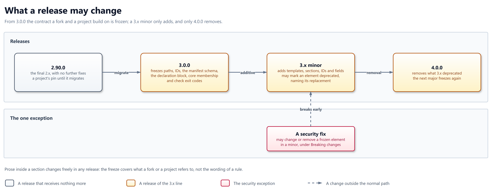

# ADR-051: What a release may change from 3.0.0

## Context

From v3.0, forks and projects build on upstream and update on their own
schedule, so they need to know what a release can break.

| Who depends on upstream | What they refer to |
| ----------------------- | ------------------ |
| A fork | Paths it merges, IDs it extends and overrides, the manifest schema it appends to |
| A project | The declaration block its context file carries, the core tier its chain resolves, the exit codes its CI reads |
| A project still on 2.x | The `v2.90.0` tag it pins |

The forces:

- Independent schedules: a fork merges upstream when it chooses, and a
  project bumps its pin when it chooses. A break they cannot see coming
  lands in their CI.
- One maintainer: upstream has the capacity for one line of releases, not
  two.
- Wording: rules are improved continually, and freezing their prose would
  stop the work the library exists for.
- Security: a flaw in a frozen element cannot wait years for a major.

## Decision

From 3.0.0, what forks and projects refer to is frozen until 4.0.0: a 3.x
release only adds or deprecates, a security fix is the one exception, and
2.x receives nothing after `v2.90.0`.

## Rationale

- Forks and projects update on their own schedules, so a frozen contract
  lets them take any 3.x release without reading it first.
- Freezing what is referred to, not the wording, keeps rules improving
  while nothing a fork or project names moves.
- One maintainer can run one release line; a 2.x branch would halve the
  attention the 3.x line gets.
- A security flaw cannot wait for a major, so the one exception is for
  security alone.

## Design

| # | Rule | In practice |
| - | ---- | ----------- |
| 1 | The frozen surface | Template paths, template and section IDs, the manifest schema, the declaration block (`Stack`, `Extras`, `Platform`), core-tier membership, and check exit codes: 0 passes, 1 fails, 3 does not apply |
| 2 | Prose is free | The wording inside a section changes in any release, as long as the rule keeps its ID |
| 3 | A minor only adds | A 3.x minor adds templates, sections, IDs and optional manifest fields. The core tier is frozen, so a new template is reached by declaring it, never by joining the core |
| 4 | Deprecate, then remove at v4 | A minor may deprecate an element by naming its replacement. Nothing frozen is removed or renamed before 4.0.0 |
| 5 | How a deprecation is marked | A deprecated template carries `deprecated: <replacement-id>` in its manifest entry; every deprecation is listed under `Deprecated` in the CHANGELOG with its replacement |
| 6 | The security exception | A security fix may change or remove a frozen element in a minor. The CHANGELOG lists it under `Breaking changes`, naming the element and the reason |
| 7 | 2.x is final | `v2.90.0` is the last 2.x release and receives no fixes; work merged after it ships in 3.0.0 |
| 8 | The next major freezes again | 4.0.0 removes what 3.x deprecated and freezes its own surface under these rules |

| Rule | Promise or mechanism | Enforced by |
| ---- | -------------------- | ----------- |
| 1, 3 | Promise to forks and projects | Smoke: every root resolves; the fork-sync CI job (#1924) |
| 2 | Promise to maintainers | - |
| 4, 5 | Promise to forks and projects | A smoke check that a `deprecated` field names an existing ID, and the release review |
| 6 | Promise to forks and projects | The CHANGELOG `Breaking changes` section at the cut |
| 7 | Promise to projects on 2.x | The migration guide (#1292) |
| 8 | Promise to forks and projects | - |

### Deprecating a template, worked through

Suppose a hypothetical `backend-cache` replaces `backend-caching` in 3.4.0:

| Release | Manifest | CHANGELOG |
| ------- | -------- | --------- |
| 3.4.0 | `backend-cache` added; `backend-caching` gains `deprecated: backend-cache` | `Deprecated`: `backend-caching`, use `backend-cache` |
| 3.5.0 to 3.x | Both resolve | - |
| 4.0.0 | `backend-caching` removed | `Removed`: `backend-caching`, deprecated in 3.4.0 |

## Alternatives considered

| Alternative | Why not |
| ----------- | ------- |
| Back-port security fixes to 2.x for six months | Two release lines for one maintainer, for a pin every project can leave by re-pinning. |
| A minor adds only, with no deprecation | A replacement could not be announced until the major that removes the old element, so forks would meet the change all at once. |
| Imbrain's rule: 24 months and until the second major | Two majors of overlap fits interfaces running on site for years; a context file is regenerated in minutes. |
| No exception for security | A security flaw would wait for 4.0.0, or force a major for one fix. |
| Freeze the prose as well | Rules could no longer be corrected, which is most of what a release does. |

## Consequences

| Consequence | Effect |
| ----------- | ------ |
| Manifest schema | Gains the optional `deprecated` field, with a smoke check that it names an existing ID |
| CHANGELOG | Uses the `Deprecated` and `Breaking changes` sections from 3.0.0 |
| Release review | Checks every diff to the frozen surface against rules 3 to 6 |
| Migration guide | States that 2.x is final and how to re-pin (#1292) |
| 2.x branch | None is kept; `v2.90.0` stays as a tag |

## Compatibility

- This record is the compatibility policy, so it changes nothing that
  exists today. It applies from 3.0.0.
- A project on 2.x keeps working on `v2.90.0` for as long as it pins it,
  but receives nothing more; every later change, fixes included, arrives
  only by migrating to 3.0.0.

## Security

- A project that stays on `v2.90.0` receives no security fixes. A flaw
  found in a 2.x template stays in its pin until it migrates, and the
  migration guide says so.
- The security exception lets a minor break a fork's chain without
  warning. The `Breaking changes` entry is the only warning, so a fork
  reads it before merging a release.
- No credentials or secrets are involved.

## Related

- ADR-049 - the fork model this record protects.
- ADR-050 - the boundary whose upstream side this record freezes.
- solid-ai-dev/solid-ai-templates#1292 - the migration guide.
