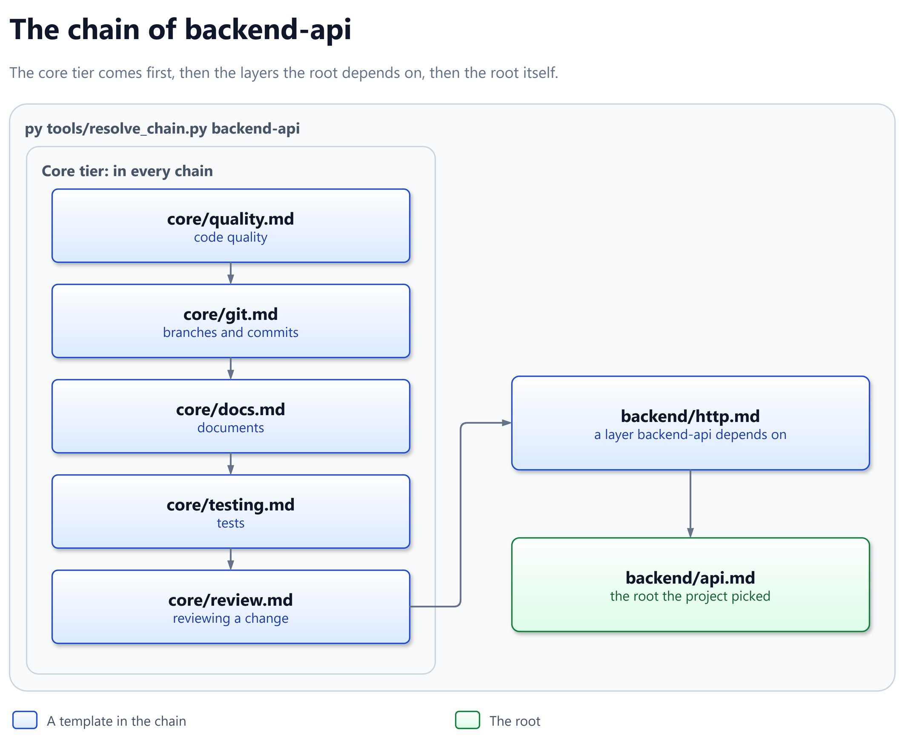

# The templates in plain words

This page explains what the templates are and how a project uses them. It
needs no programming. Each term in **bold** is defined in the
[glossary](architecture/12-glossary.md), and the full design is in the
[specification](spec.md).

## 1. The problem

AI coding agents read a note of house rules before they work, a file named
`AGENTS.md` or `CLAUDE.md`. Such a note is a **context file**.

Most projects write their note by hand. Over time it drifts: two rules
disagree, a rule names a tool the project dropped, and no one checks
whether the code follows any of it.

The templates are a shared library of such rules, written once, reviewed,
and turned into a project's context file by a tool.

## 2. An analogy

Think of a restaurant franchise. Head office wants every branch's dish to
taste the same, whoever cooks it. The templates want the same of every
agent and every session.


| In a franchise | In the templates |
| -------------- | ---------------- |
| Head office's operations manual | Upstream, this repository |
| The basics every branch follows, such as hygiene | The **core tier**: quality, Git, docs, testing and review |
| The menu sections a restaurant offers | The **roots** a project picks, such as `backend-api` |
| A regional franchise that adds local dishes and keeps taking head-office updates | A **fork** |
| A local recipe that adds to or replaces a head-office one | A section that extends or overrides another, by its **ID** |
| The dated edition of the manual one restaurant uses | The project's **pin**, a released tag |
| The rules posted at the station, read every shift | `AGENTS.md`, read on every turn |
| The recipe card fetched when a dish is ordered | A **task skill**, loaded when its task starts |
| The inspector who checks the dishes | The shipped checks and **hooks** |

A cook does not read the whole manual before each shift. The restaurant
picks its menu, and a tool hands the cook the rules that menu needs.

## 3. From roots to files


- The **manifest**, `templates/manifest.yaml`, records which template depends
  on which
- The chain is resolved from it, the same way every time
- The **emitter** writes the files. The same roots at the same release give
  the same files, byte for byte

The emitter splits the rules by when they are needed:

| File | Read | Holds |
| ---- | ---- | ----- |
| `AGENTS.md` | On every turn | The rules every change needs, the project's facts, and a table of skills |
| A **task skill** | When that task starts | The procedure for one kind of task, such as writing tests or reviewing a change |

An agent that cannot load a skill on demand gets everything in `AGENTS.md`
instead. An agent with a file of its own, such as Claude Code's `CLAUDE.md`,
gets a one-line file that points to `AGENTS.md`.

## 4. A worked example

A project building an HTTP API picks one root and looks at its chain, from
a clone of the templates beside the project:

```bash
py ../solid-ai-templates/tools/resolve_chain.py backend-api
```

```text
templates/core/quality.md
templates/core/git.md
templates/core/docs.md
templates/core/testing.md
templates/core/review.md
templates/backend/http.md
templates/backend/api.md
```



The core files come first, then the layers `backend-api` depends on, then
`backend-api` itself. From the project's own folder, the project then
writes its files:

```bash
py ../solid-ai-templates/tools/resolve_chain.py --emit . backend-api
```

The emitter writes `AGENTS.md` and one skill per task kind the chain
carries, such as `write-tests`, `change-api` and `review`. It leaves a few
placeholders, such as `{{project-name}}` and the build and test commands,
for the project to fill in.

## 5. The choices a project makes


| Choice | Options | Where it is set |
| ------ | ------- | --------------- |
| Roots | Any templates the project needs, from upstream or a fork | The roots given to the emitter |
| Delivery | Skills that load per task, or everything in `AGENTS.md` | `--inline-skills` |
| How it holds the templates | A submodule, a clone, a copy, the generated files only, or the hooks only | The project, at a released tag |
| Its own rules | None, or a fork that adds stacks, platforms and process rules | A fork of upstream |

A project always takes a released tag, never a branch, so the rules it
follows change only when it moves its **pin**.

## 6. Rules that are checked

A rule that a tool can check names its check beside it: the command, and
what passing looks like. Checks too long to write inline ship as
pre-commit hooks, which stop a commit that breaks the rule. The
[hooks page](hooks.md) shows how to install them, with or without the
templates.

## 7. What stays stable

From 3.0.0, a minor or patch release never breaks the **frozen surface**:
file paths, section IDs, the manifest's shape, the core tier, exit codes,
the hooks and the points where a fork plugs in. A rule's wording can improve in any
release; a breaking change waits for the next major, after a deprecation.

## 8. Where to go next

| To | Read |
| -- | ---- |
| Set up a project | The README's quick setup |
| Run the checks in CI | [Pre-commit hooks](hooks.md) |
| Add your own stacks | [Adapt the rules](playbook.md#61-sync-with-upstream-as-a-fork) |
| Move from 2.x | [Migrating from 2.x](migrations/v3.md) |
| Learn how it is built | [Specification](spec.md) |
| See whether the rules help | The benchmark, `solid-ai-dev/solid-ai-benchmark` |
